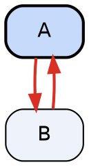
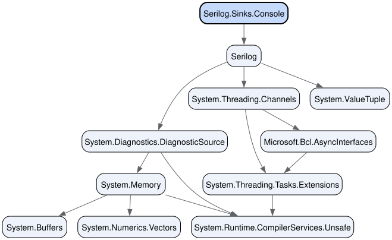
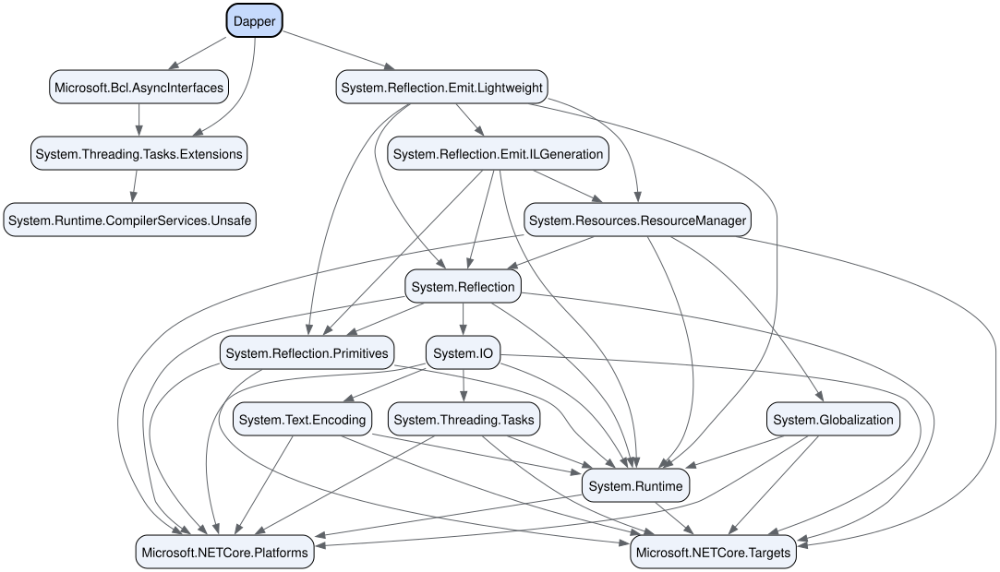
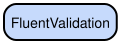
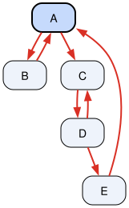

# Визуализатор графа зависимостей пакетов NuGet

Практическая работа №2, вариант №12. Инструмент визуализации графа
зависимостей для менеджера пакетов .NET (NuGet). Готовые менеджеры
пакетов и библиотеки для получения зависимостей не используются:
данные запрашиваются напрямую по HTTP из API репозитория NuGet.

Язык реализации — Python 3.11+ (нужен встроенный модуль `tomllib`),
сторонние библиотеки Python не требуются. Для построения изображения
SVG нужна программа `dot` из пакета [Graphviz](https://graphviz.org)
(macOS: `brew install graphviz`). Код соответствует стандарту PEP 8.

## Общее описание

Приложение запускается из командной строки и читает параметры
из конфигурационного файла формата TOML. Затем оно строит граф
зависимостей заданного пакета с учётом транзитивности (зависимости
зависимостей и так далее), выводит его и сообщает о циклических
зависимостях. Граф выводится на языке диаграмм Graphviz (DOT),
сохраняется в виде изображения SVG и, если задан параметр `ascii_tree`,
выводится в виде ASCII-дерева. В режиме `load_order` вместо графа
выводится порядок загрузки зависимостей.

Источник данных — реальный репозиторий NuGet или, в тестовом режиме,
текстовый файл с описанием графа.

## Структура проекта

```
src/depgraph/
    __main__.py   точка входа: аргументы, выбор источника, вывод
    config.py     чтение и проверка конфигурации TOML
    nuget.py      клиент репозитория NuGet и разбор манифеста .nuspec
    repo_file.py  файл тестового репозитория
    graph.py      построение графа (BFS) и поиск циклов
    order.py      порядок загрузки (топологическая сортировка)
    visualize.py  описание Graphviz (DOT), SVG и ASCII-дерево
tests/            модульные тесты (unittest), сеть не используется
examples/
    packages/     реальные пакеты NuGet
    repo_errors/  ошибки обращения к репозиторию NuGet
    errors/       ошибки конфигурации, по одной на каждый вид
    test_repos/   файлы тестовых репозиториев (errors/ — с ошибками)
    test_mode/    конфигурации тестового режима (errors/ — с ошибками)
    load_order/   конфигурации режима порядка загрузки
    visualize/    визуализация трёх реальных пакетов и графа с циклами
docs/images/      изображения графов, построенные примерами visualize/
scripts/          демонстрационные скрипты
config.toml       конфигурация по умолчанию
run.sh            запуск приложения и тестов
```

## Параметры командной строки

| Параметр | Описание |
|---|---|
| `-c PATH`, `--config PATH` | Путь к конфигурационному файлу TOML, по умолчанию `config.toml`. |
| `-h`, `--help` | Справка. |

## Конфигурационный файл

Первые пять параметров обязательны, `load_order` — нет:

```toml
package_name = "Serilog.Sinks.Console"
repository = "https://api.nuget.org/v3/index.json"
test_mode = false
output_file = "graph.svg"
ascii_tree = true
load_order = false
```

| Параметр | Тип | Описание и проверки |
|---|---|---|
| `package_name` | строка | Имя анализируемого пакета. Не пустое, не длиннее 100 символов, допустимое имя NuGet (латинские буквы, цифры, `_`, части через `.` или `-`). В тестовом режиме — только большие латинские буквы (`A`, `B`, …). |
| `repository` | строка | URL индекса служб репозитория NuGet v3 (`http://` или `https://`). В тестовом режиме — путь к существующему файлу тестового репозитория. |
| `test_mode` | `true`/`false` | Режим работы с тестовым репозиторием. |
| `output_file` | строка | Имя файла, в который сохраняется изображение графа в формате SVG. Расширение `.svg`, каталог для файла должен существовать. |
| `ascii_tree` | `true`/`false` | Дополнительно вывести зависимости в виде ASCII-дерева. |
| `load_order` | `true`/`false` | Необязательный, по умолчанию `false`. Вывести порядок загрузки зависимостей вместо графа. |

Также сообщается об ошибках: файл не найден или не читается, файл
не в UTF-8, неверный синтаксис TOML, отсутствующий или неизвестный
параметр, неверный тип значения.

## Получение зависимостей из NuGet

Используется API NuGet v3 и только стандартная библиотека Python
(`urllib`, `json`, `xml.etree`):

1. **Индекс служб** (`repository`) — JSON со списком ресурсов
   репозитория. Из него берётся адрес хранилища пакетов — ресурса
   `PackageBaseAddress/3.0.0`.
2. **Список версий** — `{хранилище}/{id}/index.json`. Выбирается
   последняя стабильная версия (без суффикса вида `-beta`).
3. **Манифест пакета** — `{хранилище}/{id}/{версия}/{id}.nuspec`, XML.
   В разделе `<dependencies>` перечислены прямые зависимости,
   сгруппированные по целевым платформам (`<group targetFramework>`).

Для графа берутся зависимости **всех** целевых платформ без повторов,
а у каждой зависимости — её последняя стабильная версия. Имена пакетов
NuGet сравниваются без учёта регистра.

Каждый пакет требует двух HTTP-запросов, поэтому большие графы
загружаются заметно долго; ход загрузки выводится в поток ошибок
строками `Загрузка <пакет>...`.

Ошибки репозитория: сервер недоступен, ответ с ошибкой HTTP, ответ
не JSON, адрес не является индексом служб, пакет не найден, у пакета
нет версий, неверный XML манифеста.

## Построение графа

Граф строится **обходом в ширину (BFS) без рекурсии** — с явной
очередью `collections.deque`:

1. В очередь помещается анализируемый пакет (уровень 0).
2. Из очереди берётся пакет и запрашиваются его прямые зависимости.
3. Каждая ещё не встреченная зависимость получает уровень на единицу
   больше и ставится в конец очереди; уже встреченная — только
   добавляется как связь.
4. Шаги 2–3 повторяются, пока очередь не опустеет.

Так каждый пакет загружается ровно один раз, а **циклические
зависимости** не приводят к бесконечному обходу. После построения циклы
находятся обходом в глубину с явным стеком (тоже без рекурсии): связь
с пакетом, который находится на текущем пути обхода, замыкает цикл.
Для каждой такой связи выводится один цикл.

## Тестовый режим

При `test_mode = true` вместо URL указывается путь к файлу описания
графа. Пакеты называются большими латинскими буквами, каждая строка —
пакет и через двоеточие его прямые зависимости:

```
# комментарий
A: B C
B: D
C: D E
D:
E:
```

Каждый пакет описывается один раз, все зависимости должны быть описаны
в том же файле. Пустые строки и строки с `#` пропускаются. Ошибки
выводятся с номером строки: строка без двоеточия, имя не из больших
латинских букв, повторное описание пакета, неописанная зависимость,
анализируемый пакет не найден.

Примеры в `examples/test_repos/`:

| Файл | Случай |
|---|---|
| `simple.txt` | общая зависимость двух пакетов |
| `single.txt` | пакет без зависимостей |
| `chain.txt` | цепочка из 6 уровней |
| `cycle.txt` | цикл из трёх пакетов |
| `self_cycle.txt` | пакет зависит сам от себя |
| `many_cycles.txt` | несколько циклов |
| `unreachable.txt` | пакеты, не связанные с анализируемым, в граф не попадают |
| `diamond.txt` | многоуровневый ромб |

## Вывод

```
Граф зависимостей пакета A: пакетов 4, связей 4
  [0] A -> B
  [1] B -> C
  [2] C -> A, D
  [3] D -> (нет зависимостей)
Циклические зависимости: 1
  A -> B -> C -> A
```

В квадратных скобках — уровень обхода в ширину (расстояние от
анализируемого пакета), пакеты перечислены в порядке обхода.

## Визуализация

Без режима `load_order` программа выводит:

1. сводку по графу — пакеты по уровням обхода в ширину и найденные циклы;
2. **описание графа на языке Graphviz (DOT)**;
3. сообщение о сохранении изображения в файл `output_file` (SVG);
4. при `ascii_tree = true` — **ASCII-дерево** зависимостей.

### Описание на языке DOT



Каждый пакет — вершина, каждая зависимость — стрелка от пакета
к зависимости. Анализируемый пакет выделен цветом и толстой рамкой,
связи, входящие в циклы, — красным.

### Изображение SVG

Описание DOT передаётся программе Graphviz: `dot -Tsvg -o <output_file>`.
Если Graphviz не установлен или завершился с ошибкой, выводится
сообщение, остальной вывод сохраняется, а код завершения — 5.

### ASCII-дерево

Дерево разворачивается от анализируемого пакета обходом в глубину
с явным стеком (без рекурсии). Чтобы дерево не разрасталось, пакет,
уже показанный выше, повторно не разворачивается и помечается `(*)`;
зависимость, замыкающая цикл, помечается `(цикл)`.

```
A
├── B
│   └── A (цикл)
└── C
    └── D
        ├── C (цикл)
        └── E
            └── A (цикл)
```

### Примеры для трёх пакетов

Скрипт `scripts/demo_visualize.sh` строит изображения для конфигураций
из `examples/visualize/` и сохраняет их в `docs/images/`.

**Serilog.Sinks.Console** — 11 пакетов, 13 связей:



```
Serilog.Sinks.Console
└── Serilog
    ├── System.Diagnostics.DiagnosticSource
    │   ├── System.Memory
    │   │   ├── System.Buffers
    │   │   ├── System.Numerics.Vectors
    │   │   └── System.Runtime.CompilerServices.Unsafe
    │   └── System.Runtime.CompilerServices.Unsafe (*)
    ├── System.Threading.Channels
    │   ├── Microsoft.Bcl.AsyncInterfaces
    │   │   └── System.Threading.Tasks.Extensions
    │   │       └── System.Runtime.CompilerServices.Unsafe (*)
    │   └── System.Threading.Tasks.Extensions (*)
    └── System.ValueTuple
```

**Dapper** — 16 пакетов, 43 связи:



**FluentValidation** — пакет без зависимостей, граф из одной вершины:



**Тестовый граф с циклами** (`examples/test_repos/many_cycles.txt`):



### Сравнение со штатными инструментами NuGet

Для сравнения использованы инструменты .NET SDK 11.0.100 на проекте
с зависимостью от `Serilog.Sinks.Console` 6.1.1 (проект создаёт
`scripts/compare_dotnet.sh`):

- `dotnet list package --include-transitive` — плоский список прямых
  и транзитивных пакетов с версиями, отдельно для каждой платформы;
- `dotnet nuget why <проект> <пакет>` — дерево путей от прямых
  зависимостей проекта до заданного пакета.

Вывод `dotnet nuget why` для System.Runtime.CompilerServices.Unsafe:

```
[netstandard2.0]
└── Serilog.Sinks.Console@6.1.1 (>= 6.1.1)
    └── Serilog@4.0.0 (>= 4.0.0)
        ├── System.Diagnostics.DiagnosticSource@8.0.1 (>= 8.0.1)
        │   ├── System.Memory@4.5.5 (>= 4.5.5)
        │   │   └── System.Runtime.CompilerServices.Unsafe@6.0.0 (>= 4.5.3)
        │   └── System.Runtime.CompilerServices.Unsafe@6.0.0 (>= 6.0.0)
        └── System.Threading.Channels@8.0.0 (>= 8.0.0)
            └── System.Threading.Tasks.Extensions@4.5.4 (>= 4.5.4)
                └── System.Runtime.CompilerServices.Unsafe@6.0.0 (>= 4.5.3)
```

**Совпадает:** структура дерева и связи между пакетами — пути
Serilog → DiagnosticSource → Memory → Unsafe и Serilog → Channels →
Tasks.Extensions → Unsafe есть и в ASCII-дереве depgraph.

**Расхождения и их причины:**

1. **Что показывается.** `dotnet nuget why` показывает только пути
   к одному заданному пакету, depgraph — всё дерево от анализируемого
   пакета. Штатного инструмента, который рисует граф целиком, в .NET SDK
   нет (в Visual Studio это дерево «Зависимости» в обозревателе решений,
   а изображение строят сторонние утилиты).
2. **Повторы.** `dotnet nuget why` повторяет пакет на каждом пути
   (Unsafe выведен три раза), depgraph разворачивает его один раз,
   а дальше ставит пометку `(*)` — иначе для больших графов дерево
   разрасталось бы экспоненциально. На SVG-изображении каждый пакет —
   одна вершина.
3. **Версии.** NuGet показывает выбранную версию и требуемый диапазон
   (`Unsafe@6.0.0 (>= 4.5.3)`). depgraph версии не выводит: он строит
   граф по последним версиям пакетов, а NuGet выбирает наименьшие
   подходящие версии (подробнее — в разделе о порядке загрузки).
   Из-за этого у depgraph есть лишняя ветка Microsoft.Bcl.AsyncInterfaces:
   она нужна System.Threading.Channels 11.0.0, но не версии 8.0.0,
   которую выбрал NuGet.
4. **Платформы.** NuGet строит отдельное дерево для каждой целевой
   платформы проекта (для net11.0 путей к Unsafe нет вовсе — пакет входит
   в саму платформу), depgraph объединяет зависимости всех платформ
   в один граф. Поэтому System.ValueTuple (нужен только net462) есть
   в дереве depgraph, но отсутствует в дереве NuGet для netstandard2.0.

## Порядок загрузки зависимостей

При `load_order = true` выводится порядок, в котором нужно загружать
пакеты: каждый пакет — только после всех своих зависимостей,
анализируемый пакет — последним. Это топологическая сортировка графа;
она выполняется алгоритмом Кана без рекурсии:

1. Для каждого пакета считается число ещё не загруженных зависимостей.
2. Пакеты, у которых это число равно нулю, ставятся в очередь
   (в порядке обхода в ширину, чтобы результат был одинаковым).
3. Пакет из очереди загружается, и у всех пакетов, которые от него
   зависят, счётчик уменьшается на единицу; ставшие готовыми пакеты
   добавляются в очередь.

```
$ ./run.sh -c examples/load_order/simple.toml
Порядок загрузки зависимостей пакета A:
  1. D
  2. E
  3. B
  4. C
  5. A (анализируемый пакет)
```

Если в графе есть цикл, пакеты цикла и всё, что от них зависит, никогда
не становятся готовыми — порядок для них определить нельзя. Выводятся
пакеты, которые загрузить можно, список заблокированных пакетов и сами
циклы, программа завершается с кодом 4:

```
$ ./run.sh -c examples/load_order/cycle.toml
Порядок загрузки зависимостей пакета A:
  1. D
Порядок загрузки нельзя определить из-за циклических зависимостей для пакетов: A, B, C
  A -> B -> C -> A
```

## Сравнение с реальным менеджером пакетов

Сравнение выполнено с .NET SDK 11.0.100 (`dotnet restore`) для пакета
`Serilog.Sinks.Console` 6.1.1 и проекта сразу для трёх платформ.
Повторить его можно скриптом `scripts/compare_dotnet.sh` (нужен
установленный `dotnet`).

| Пакет | depgraph | dotnet, net462 | dotnet, netstandard2.0 | dotnet, net8.0 |
|---|---|---|---|---|
| System.ValueTuple | 1 | 4.5.0 | — | — |
| System.Runtime.CompilerServices.Unsafe | 2 | 6.0.0 | 6.0.0 | — |
| System.Buffers | 3 | 4.5.1 | 4.5.1 | — |
| System.Numerics.Vectors | 4 | 4.5.0 | 4.4.0 | — |
| System.Threading.Tasks.Extensions | 5 | 4.5.4 | 4.5.4 | — |
| System.Memory | 6 | 4.5.5 | 4.5.5 | — |
| Microsoft.Bcl.AsyncInterfaces | 7 | — | — | — |
| System.Diagnostics.DiagnosticSource | 8 | 8.0.1 | 8.0.1 | — |
| System.Threading.Channels | 9 | 8.0.0 | 8.0.0 | — |
| Serilog | 10 | 4.0.0 | 4.0.0 | 4.0.0 |
| Serilog.Sinks.Console | 11 | 6.1.1 | 6.1.1 | 6.1.1 |

В столбце depgraph — номер в порядке загрузки, в столбцах dotnet —
версия, которую выбрал NuGet («—» — пакет не нужен).

**Порядок совпадает по смыслу.** `dotnet restore` загружает пакеты
параллельно и порядок загрузки не выводит, но зависимости в нём
устанавливаются раньше зависящих от них пакетов — это и есть
топологический порядок. Если подставить в depgraph граф, который
построил NuGet для net462 (из `obj/project.assets.json`), получается
почти тот же порядок: без Microsoft.Bcl.AsyncInterfaces, а
System.Threading.Channels и System.Diagnostics.DiagnosticSource меняются
местами (Channels больше не ждёт Microsoft.Bcl.AsyncInterfaces).
Топологических порядков обычно несколько, поэтому пакеты, не зависящие
друг от друга, могут идти в разном порядке — это не ошибка.

**Расхождения и их причины:**

1. **Версии.** NuGet для зависимости `Serilog >= 4.0.0` выбирает
   *наименьшую* подходящую версию (правило lowest applicable version) —
   4.0.0. depgraph берёт *последнюю* стабильную версию каждого пакета
   (Serilog 4.4.0, System.Threading.Channels 11.0.0), потому что
   не решает задачу подбора версий.
2. **Лишний пакет Microsoft.Bcl.AsyncInterfaces.** Он нужен
   System.Threading.Channels 11.0.0 (последней версии), но не нужен
   версии 8.0.0, которую выбрал NuGet. Это следствие пункта 1.
3. **Платформы.** NuGet разрешает зависимости отдельно для каждой
   целевой платформы проекта: для net8.0 нужен только Serilog,
   остальные пакеты входят в саму платформу. depgraph объединяет
   зависимости всех платформ, поэтому его граф — объединение графов
   NuGet для всех платформ.
4. **Служебные пакеты.** NuGet добавляет пакеты, которых нет
   в зависимостях: Microsoft.NETFramework.ReferenceAssemblies для
   net462, NETStandard.Library и Microsoft.NETCore.Platforms для
   netstandard2.0. Их подключает сам .NET SDK, а не анализируемый пакет.
5. **Циклы.** NuGet при цикле завершается ошибкой NU1108 «Cycle
   detected». depgraph тоже сообщает об ошибке (код 4), но дополнительно
   выводит пакеты, которые загрузить можно, и сами циклы.

## Коды завершения

| Код | Значение |
|---|---|
| 0 | Успешно. |
| 1 | Ошибка конфигурации. |
| 2 | Неверные аргументы командной строки. |
| 3 | Ошибка репозитория NuGet или файла тестового репозитория. |
| 4 | Режим `load_order`: порядок нельзя определить из-за цикла. |
| 5 | Не удалось построить SVG: Graphviz не установлен или выдал ошибку. |

## Сборка и запуск

Сборка не требуется. Для работы с реальным репозиторием нужен доступ
в интернет.

```bash
./run.sh
./run.sh -c examples/test_mode/cycle.toml
```

## Тесты

Модульные тесты (к сети не обращаются):

```bash
./run.sh test
```

Демонстрационные скрипты:

| Скрипт | Что показывает |
|---|---|
| `scripts/demo_test_mode.sh` | все случаи тестового репозитория и его ошибки |
| `scripts/demo_load_order.sh` | порядок загрузки для тестовых графов и реальных пакетов |
| `scripts/demo_visualize.sh` | DOT, SVG и ASCII-дерево для трёх пакетов и графа с циклами (нужен Graphviz) |
| `scripts/compare_dotnet.sh` | сравнение с `dotnet restore` (нужен .NET SDK) |
| `scripts/demo.sh` | графы реальных пакетов NuGet и ошибки репозитория (нужен интернет, работает несколько минут) |
| `scripts/demo_errors.sh` | обработку ошибок для всех параметров конфигурации |
